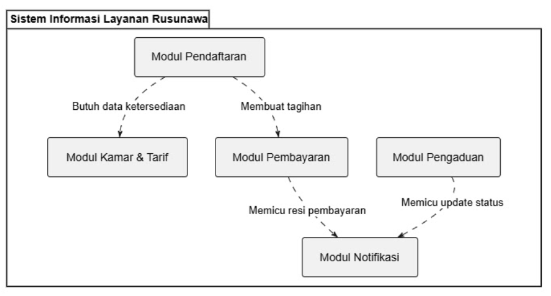
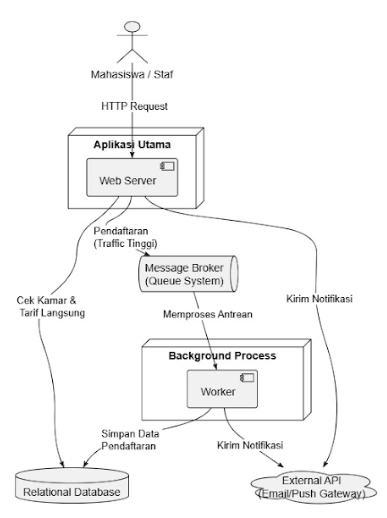
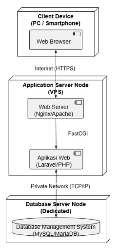

# B3. Tiga Struktur Arsitektur

<!-- Penanggung jawab: Nurul Qamri Ramadhina -->

Berdasarkan keputusan arsitektur yang telah diambil, rancangan Sistem Informasi Layanan Rusunawa ini dibagi ke dalam tiga sudut pandang struktur utama untuk memudahkan proses implementasi:

### 1. Struktur Modul (Module View)
Struktur ini menggambarkan bagaimana kode dan fungsi sistem dibagi menjadi unit-unit logis. Pendekatan ini memudahkan pembagian tugas saat proses penulisan kode (*coding*).
* **Modul Pendaftaran:** Mengelola logika pendaftaran awal mahasiswa. Modul ini membutuhkan data dari Modul Kamar & Tarif.
* **Modul Kamar & Tarif:** Mengelola data master kamar dan perhitungan tarif sewa yang berbeda untuk keempat lantai.
* **Modul Pembayaran:** Menangani validasi dan pencatatan riwayat pembayaran berdasarkan tagihan dari pendaftaran.
* **Modul Pengaduan:** Mengelola *state management* (status pelacakan) untuk laporan kerusakan fasilitas.
* **Modul Notifikasi:** Menangani pengiriman pembaruan status ke email/perangkat mahasiswa, yang dipicu oleh Modul Pengaduan dan Modul Pembayaran.

*(Berikut adalah diagram struktur modul sistem rusunawa)*

### 2. Struktur Komponen dan Konektor (C&C View)
Struktur ini menunjukkan elemen sistem pada saat *runtime* (sistem sedang berjalan) dan bagaimana data mengalir, khususnya saat terjadi lonjakan pendaftaran.
* **Client (Mahasiswa/Staf):** Aktor yang mengirimkan *HTTP Request* ke sistem.
* **Web Server:** Memproses *request* secara langsung atau meneruskannya ke antrean.
* **Message Broker (Queue System):** Menampung antrean pendaftaran saat *traffic* tinggi untuk mencegah *race condition* (ADR-001).
* **Background Worker:** Memproses antrean di belakang layar secara berurutan dan menyimpan datanya ke *database*.
* **Relational Database:** Tempat penyimpanan utama untuk data entitas secara aman.
* **External API:** Layanan pihak ketiga (*Email/Push Gateway*) untuk memfasilitasi pengiriman notifikasi terpusat (ADR-003).

*(Berikut adalah diagram komponen dan konektor saat sistem berjalan)*

### 3. Struktur Alokasi (Allocation/Deployment View)
Struktur ini memetakan perangkat lunak ke dalam lingkungan infrastruktur jaringan dan perangkat keras (*server*).
* **Client Device:** Laptop atau *smartphone* pengguna yang menjalankan *Web Browser* dan terhubung melalui internet (HTTPS).
* **Application Server Node:** Berupa *Virtual Private Server* (VPS) yang menjalankan *Web Server* (seperti Nginx) dan aplikasi utama (misal: Laravel/PHP) yang berkomunikasi via FastCGI.
* **Database Server Node:** *Server* terdedikasi terpisah yang mengelola *Database Management System* (MySQL/MariaDB) dan terhubung ke *Application Server* melalui *Private Network* (TCP/IP) demi keamanan data.

*(Berikut adalah diagram alokasi arsitektur fisik dan jaringan)*

